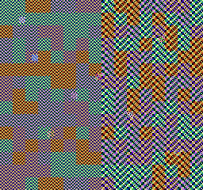
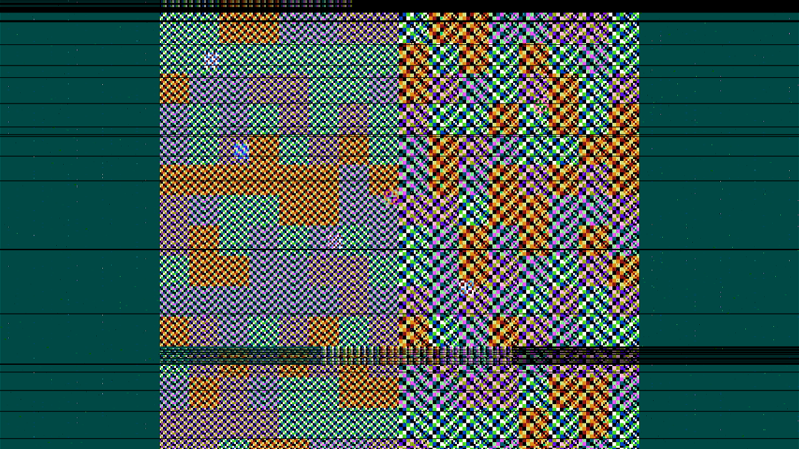

# mistang-core-nes

Nintendo Entertainment System for MiSTang (Sipeed Tang Nano 20K). The console logic is the one from [NES_MiSTer](https://github.com/MiSTer-devel/NES_MiSTer): the 2A03 CPU (T65 6502), the PPU with sprites and scrolling, the APU, OAM DMA and the joypad port. Only the cartridge board and the memories are replaced.

- `upstream/`: NES_MiSTer sources. Edits so that yosys-slang and Verilator accept them (behaviour unchanged): `PPU.sys_type` is an `input`, a few `wire`s that are assigned in `always` blocks are `reg`, `import regs_savestates::*;` added to `nes.v` and `apu.sv`.
- `rtl/nes_cart.sv`: replaces the upstream `cart_top` (all mappers) with a plain NROM board: 16 KB PRG, 8 KB CHR ROM, fixed vertical mirroring. Mappers other than 0 are **not** supported yet.
- `rtl/nes_stubs.sv`: savestates are off (`savestates`, `statemanager`, `eReg_SavestateV` reduce to their reset value).
- `rtl/t65_netlist.v` + `rtl/t65_wrap.v`: the VHDL 6502 through GHDL (`tools/ghdl_nes.sh`).
- `rtl/nes_sys.sv`: the NES core plus block RAM for PRG/CHR ROM, 2 KB CPU RAM, 2 KB nametable RAM, the joypad shift register and a 256x240 frame buffer.
- `rtl/top/nes_top.sv`, `rtl/nes_scale.sv`: 720p60 HDMI at 3x3, S1 = A, S2 = B. The master clock is 21.6 MHz (the console: 21.477 MHz, +0.6 %).
- `rom/`: an original mapper-0 test cartridge (`tools/gen_cart.py`): a tile pattern, attribute and palette RAM, eight sprites with flips and priority, OAM DMA, and the NMI handler reads button A and changes the backdrop. `tools/ref_frame.py` draws the expected frame from the data tables, not from the RTL.
- `build.sh`: yosys + nextpnr + gowin_pack. About 7 000 LUT4, timing met for the 21.6 MHz core clock and the 74.25 MHz pixel clock.

## Status (honest)

- Simulation (`sim/run_vl.sh`, Verilator): the whole 256x240 frame equals the reference exactly, 61 440 of 61 440 pixels, both with button A released and held. The picture above is that frame.
- Board: the bitstream loads, the NES clock locks, the reset is released and frames complete (the status colours of the border in the capture say so), and the capture shows the test picture's structure. **It does not match the reference** (about 70 % of pixels differ after best alignment) and the capture is torn. Earlier heavy cores showed the same capture-card degradation, so I cannot yet say whether the cause is the card or the design; this is not verified. Treat the board result as "starts, picture not confirmed".
- Not done: mappers beyond NROM, sound output (the APU runs, nothing is sent to HDMI), real cartridge loading from SD, savestates, PAL.

GPL like upstream (`LICENSE`, `upstream/COPYING`); the authors are credited in the upstream sources.
